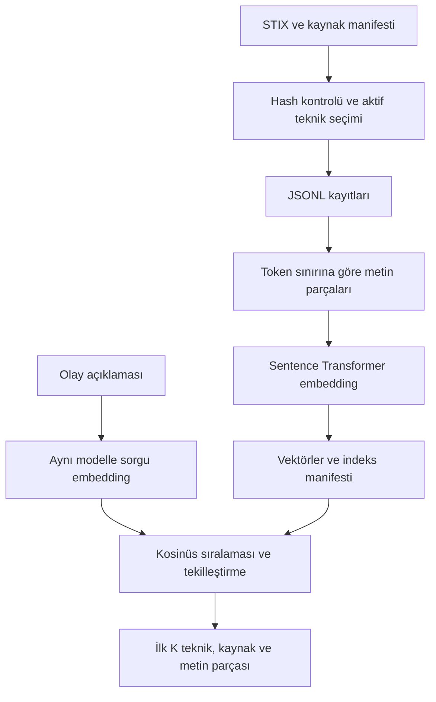

# Hafta 4 - Teknoloji ve mimari

## Kararlar

| Bileşen | Seçim | Gerekçe |
|---|---|---|
| Çalışma ortamı | Python 3.12 | Staj ortamından bağımsız sanal ortam |
| Veri | ATT&CK Enterprise STIX/JSON | Planın resmî bilgi kaynağı |
| Embedding | Sentence Transformers | Plandaki metin gösterimi yaklaşımı |
| İlk model | paraphrase-multilingual-MiniLM-L12-v2 | İki dilde demo çalıştı; genel başarı ölçümü sonraki aşama |
| Arama | NumPy, normalize vektörlerin iç çarpımı | Küçük derlemde açık ve denetlenebilir kosinüs sıralaması |
| Saklama | JSON/JSONL ve NPY | Ayrı veritabanı servisi gerektirmeyen ilk sürüm |
| Çalıştırma | Komut satırı | 7. hafta için yeterli; arayüz 11. haftada |
| Sonraki aşama | Ollama ve Streamlit | Şimdilik kuruluma zorunlu eklenmez |

Model kartı modelin 384 boyutlu cümle/paragraf temsili ürettiğini belirtir.
Gerçek indeks boyutu çalışma sırasında doğrulanıp manifestte kaydedilecektir.
Kaynak: https://huggingface.co/sentence-transformers/paraphrase-multilingual-MiniLM-L12-v2

## Veri akışı

Teknik açıklamaları modelin token sınırına göre örtüşen parçalara bölünür.
Her parça teknik kimliğine bağlıdır. Aynı tekniğin en yüksek benzerlikli
parçası o tekniği temsil eder. Sonuçlar benzersiz teknik kimlikleriyle sunulur.
Bu sürümde alt teknikler ayrı adaydır; üst tekniklere toplama yapılmaz.

Model yükleme süresi sorgu+arama ölçümüne dahil değildir ve çıktıda belirtilir.
Bu demo süreleri, 13. haftadaki kontrollü yöntem karşılaştırmasının yerine geçmez.
